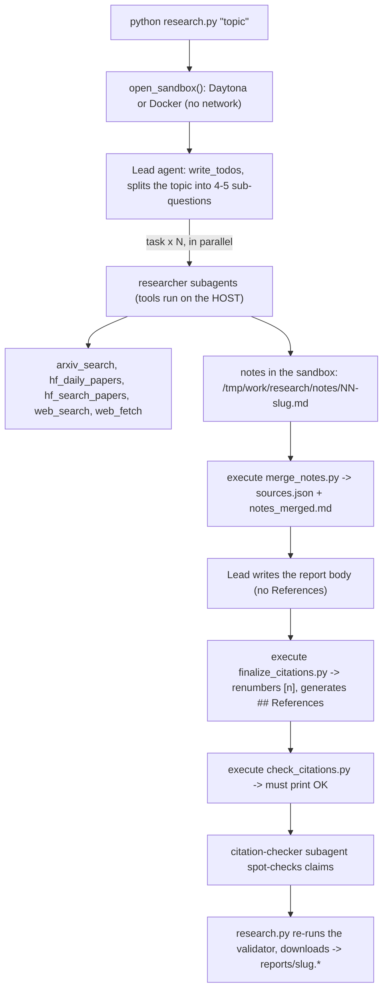

# Deep Research Agent (Deep Agents + Sandbox)

A **multi-agent deep-research system** built with LangChain's Deep Agents: you give it a topic (e.g.
`survey about world model`). A lead agent plans and splits the topic into sub-questions, then runs several
`researcher` subagents in parallel. They search arXiv, Hugging Face and the web (Exa MCP). The lead writes a
**cited survey report**, which is checked automatically inside a sandbox.

Lab: Day 23 - Track 3 - LangGraph & Agentic Orchestration (VinUni AI20k). Lab instructions: [`GUIDE.md`](GUIDE.md),
grading: [`RUBRIC.md`](RUBRIC.md), report structure: [`REPORT_TEMPLATE.md`](REPORT_TEMPLATE.md).

## How it works



| File | Role |
|---|---|
| `tools.py` | `with_retry` (exponential backoff + jitter, `Retry-After`, `cap`) and the 5 source tools. Each returns a string and never raises: `NO RESULTS` or `ERROR: ...`. Handles Exa's HTTP-200 rate limit (`result._meta["ai.exa/rateLimited"]`), redacts `EXA_API_KEY`, spaces arXiv calls 3 s apart across threads. |
| `agents.py` | Lead / researcher / citation-checker prompts, the 2 subagents, the lead Deep Agent. Model/tool call limits for the lead **and** every subagent (`ModelCallLimitMiddleware`, `ToolCallLimitMiddleware`), plus `RECURSION_LIMIT`. |
| `research.py` | Main script: sandbox lifecycle, upload of the scripts, agent run, final validation, download, `reports/<slug>.{md,sources.json,meta.json}`. A failed run exits 1 and writes nothing. |
| `check_citations.py` | Citation validator (standard library only, runs inside the sandbox). |
| `merge_notes.py` | Deterministic merge of the researchers' notes into `sources.json` (numbered, deduplicated, URL matches its source family). Runs inside the sandbox. |
| `finalize_citations.py`, `model.py`, `sandbox.py`, `self_check.py` | Provided by the lab, unchanged. |
| `tests/test_lab.py` | Offline tests (no network, no LLM) for retry, tool parsing, slugify, validator, merge, `save_outputs`. |

Security: every network tool and every API key stays on the host. The sandbox only holds files and runs the
three scripts, and it has no network access. Web content is treated as untrusted data in every prompt.

## Setup

```bash
python -m venv .venv
source .venv/bin/activate        # Windows: .venv\Scripts\activate
pip install -r requirements.txt
cp .env.example .env             # then fill in YOUR keys; .env is git-ignored
```

`.env`:

- **LLM** (must support tool calling): either `LAB_MODEL=<provider>:<model>` plus the provider key, or an
  OpenAI-compatible endpoint: `LAB_BASE_URL`, `LAB_MODEL`, `LAB_API_KEY`. The reports in this repo were generated with
  `LAB_MODEL=google_genai:gemini-3.5-flash-lite` + `GOOGLE_API_KEY` (free tier), through the native
  `langchain-google-genai` integration (in `requirements.txt`). Gemini through its OpenAI-compatible endpoint does not
  work with Deep Agents: it answers `MALFORMED_FUNCTION_CALL` (2.5) or rejects tool calls without `thought_signature` (3.x).
- **Sandbox**: `DAYTONA_API_KEY`, or `SANDBOX=docker` to use a local Docker container (`python:3.12-slim`, no
  network). The reports in this repo were generated with `SANDBOX=docker`.
- **`EXA_API_KEY`** (optional): without it the free Exa MCP tier is rate limited; the tools then retry.

## Run

```bash
python tools.py                                   # try the 5 source tools (no LLM)
python research.py "survey about world model"     # one report, ~4-10 minutes; lead trace in logs/<slug>.trace.md
python -m pip install pytest && python -m pytest -q tests   # offline tests
python check_citations.py reports/survey-about-world-model.md reports/survey-about-world-model.sources.json
python self_check.py                              # checks all 5 topics of topics.md + git secrets (no cost)
```

## Reading `reports/`

One run per topic of [`topics.md`](topics.md); each produces three files named after the topic slug:

| File | Content |
|---|---|
| `<slug>.md` | The survey: TL;DR, Background, 3-6 themes, Trends and open problems, `## References` (one line per source, generated by `finalize_citations.py`). |
| `<slug>.sources.json` | The cited sources `[{n, id, url, title, date, source}]`. `n` matches the `[n]` in the report. `source` is the tool family that found it: `arxiv`, `hf-daily`, `hf-search` or `web`. |
| `<slug>.meta.json` | Evidence of the run: `model`, `elapsed_s`, `subagent_calls` (lead's `task` calls), `tool_calls`, `tokens` (lead messages only; subagent tokens are not counted), `n_sources`, `source_families`. |

The reports are exactly the files downloaded from the sandbox after the validator printed `OK` there; they are not
edited by hand.
